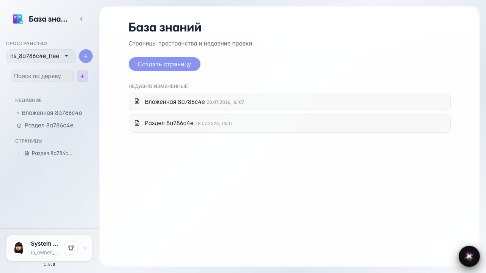
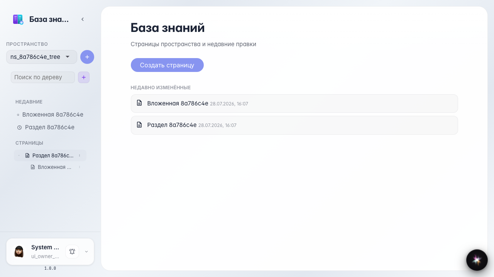
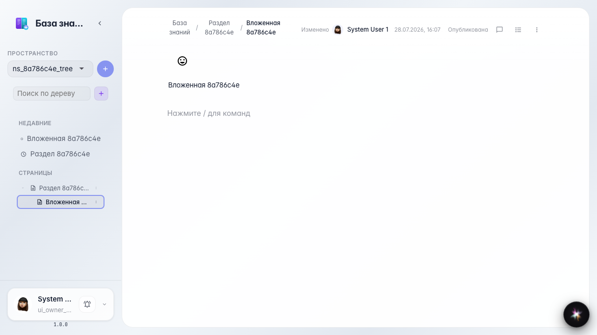

# Wiki: навигация по дереву страниц

Раскрытие раздела в дереве и переход к вложенной странице.

## Шаг 1. В дереве появился раздел

## Шаг 2. Раздел раскрыт, видна вложенная страница

## Шаг 3. Вложенная страница открыта

