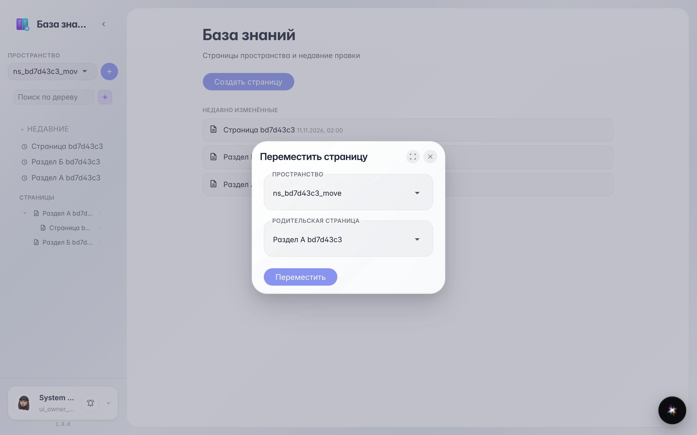
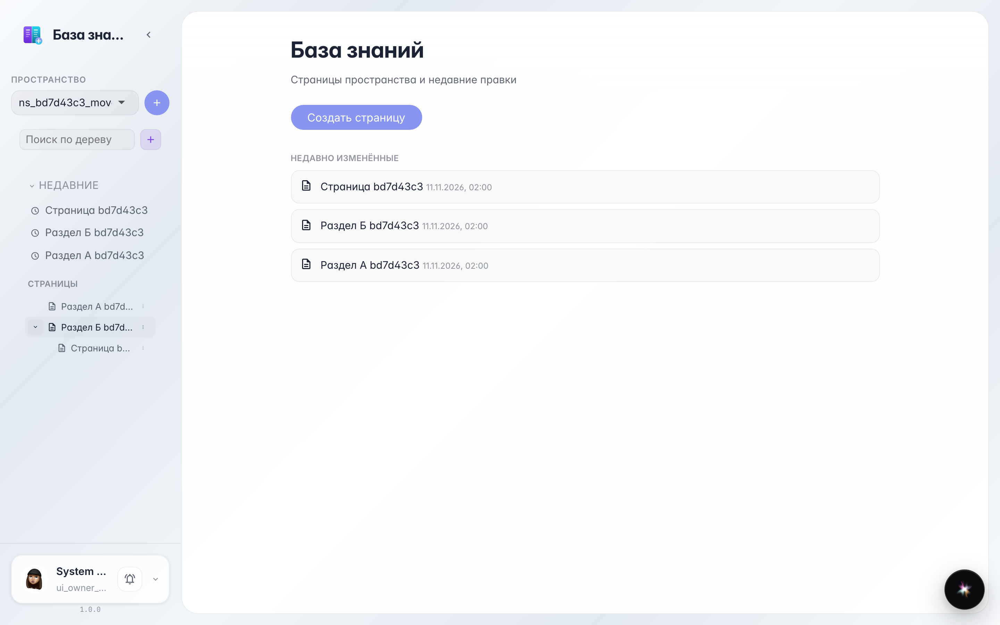

# Wiki: move a page to another section

The page tree menu lets you move a page into another section or to the space root.

## Step 1. The page sits in section A

In the left tree the page is nested under Section A. To move it, right-click the page row and choose Move.

## Step 2. Pick the new section in the dialog

In the Move page dialog pick the space and the new parent page — or To root to put the page at the top level.

## Step 3. The page moved to section B

**Result demonstration.** In the tree the page is now nested under Section B — the whole link structure and nested pages are preserved.

**Summary.** Knowledge base sections can be restructured without copy-paste.

