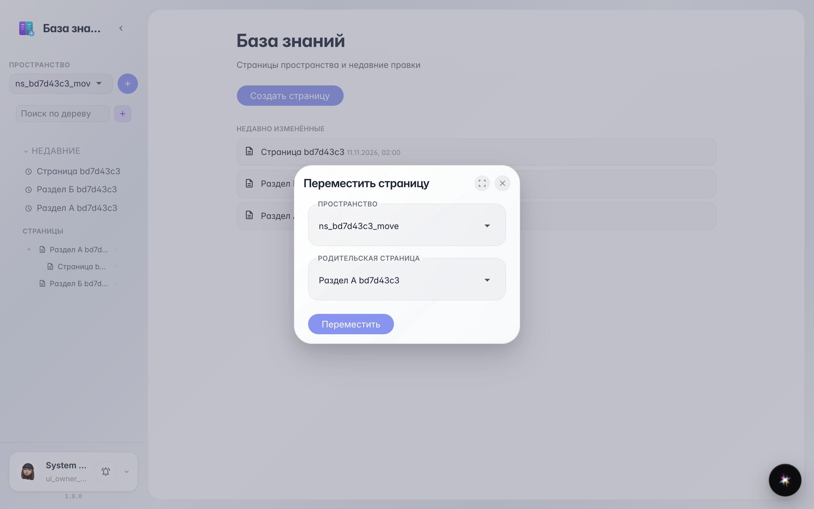
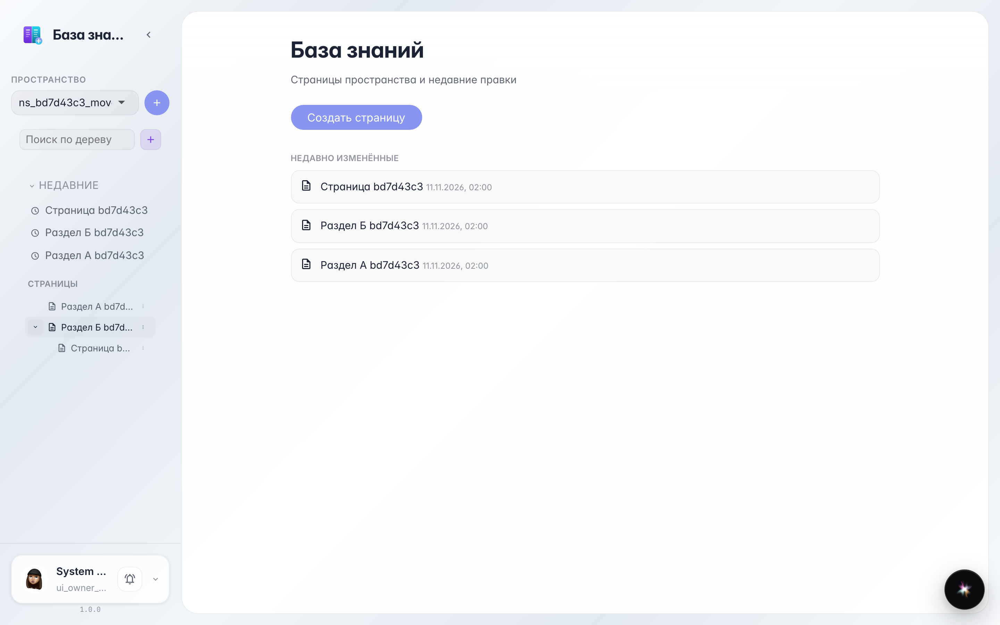

# Wiki: перемещение страницы в другой раздел

Через меню страницы в дереве её можно перенести в другой раздел или в корень пространства.

## Шаг 1. Страница лежит в разделе А

В дереве слева страница вложена в «Раздел А». Чтобы перенести её, нажмите правой кнопкой по строке страницы и выберите «Переместить».

## Шаг 2. Выберите новый раздел в диалоге

В диалоге «Переместить страницу» выберите пространство и новую родительскую страницу — или «В корень», чтобы страница оказалась на верхнем уровне.

## Шаг 3. Страница перенесена в раздел Б

**Демонстрация результата.** В дереве страница теперь вложена в «Раздел Б» — вся структура ссылок и вложенных страниц сохранилась.

**Итог.** Разделы базы знаний перестраиваются без копипаста.

