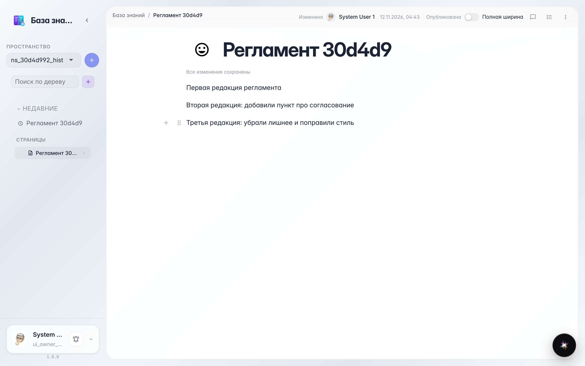
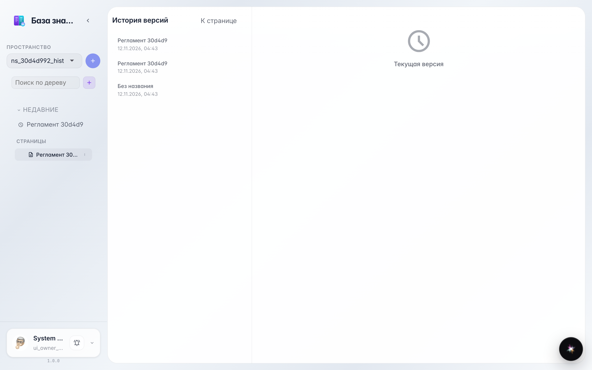
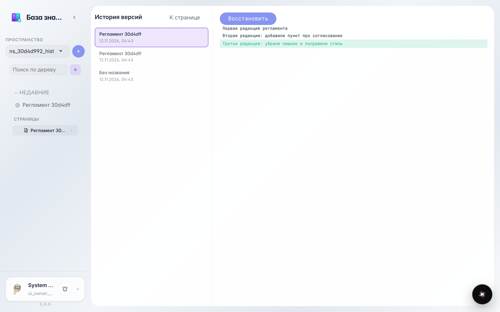
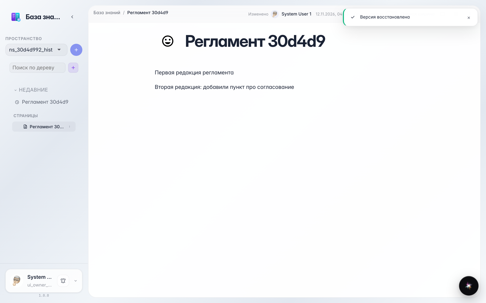

# Version history: review and restore a page

**What for:** this guide shows where all previous versions of a page live and how to bring any of them back in one action.

**Problems it solves:** if a paragraph is deleted by accident or a colleague rewrote a section, nothing is lost — you can see what changed and roll back.

**Result:** you open history, compare a revision with the current text, and restore the version you need.

## Step 1. Edit the page a couple of times

Every save records a page version. We wrote two variants of the text, so the history now holds two revisions.

## Step 2. Open History from the page menu

Choose History in the page menu — the revision list with date and author is on one side, the selected revision preview on the other.

## Step 3. Pick the old revision and compare

Click an earlier revision — the difference with the current text is highlighted on the right: what was removed and what was added. You see exactly what the page will return to.

## Step 4. Press Restore — the page rolls back

The Restore button brings back the chosen version: the page looks like it did before the last edit. The rollback itself is recorded in history too — nothing is lost.

