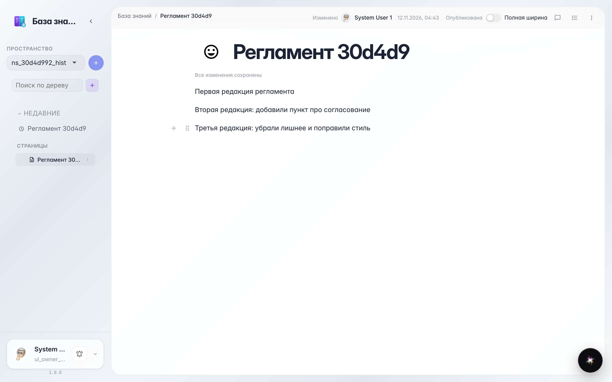
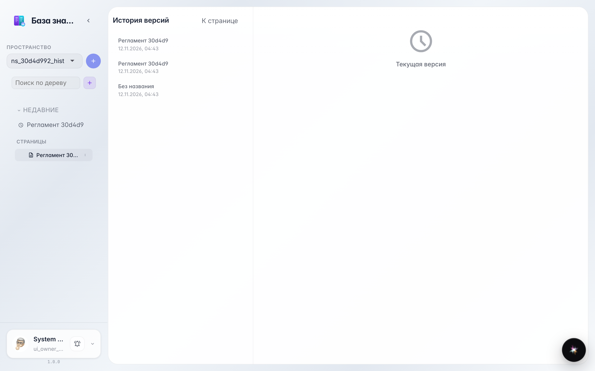
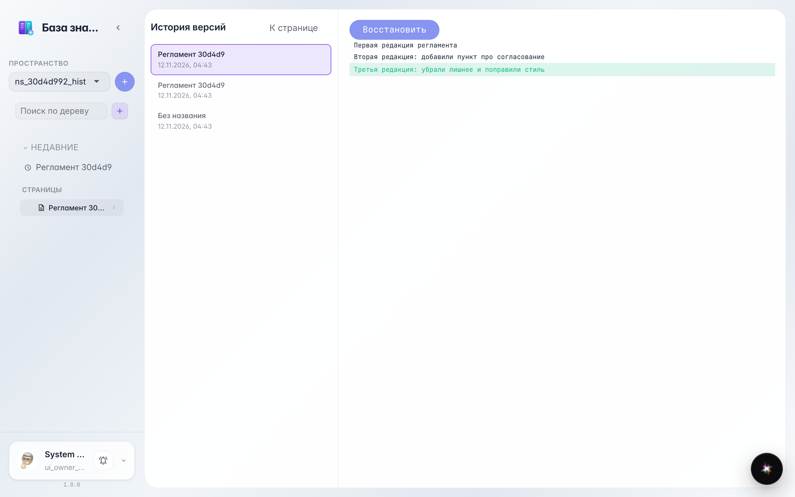
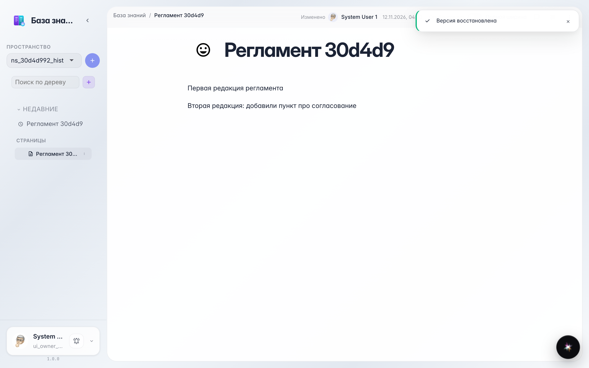

# История версий: посмотреть и откатить страницу

**Для чего:** эта инструкция покажет, где лежат все прошлые версии страницы и как вернуть любую из них одним действием.

**Какие проблемы решает:** случайно удалили абзац или коллега переписал раздел — текст не потерян, всегда можно посмотреть, что было, и откатиться.

**Результат:** вы открываете историю, сравниваете ревизию с текущим текстом и восстанавливаете нужную версию.

## Шаг 1. Отредактируйте страницу пару раз

Каждое сохранение запоминает версию страницы. Мы написали два варианта текста — теперь в истории их две ревизии.

## Шаг 2. Откройте «Историю» в меню страницы

В меню страницы выберите «История» — справа список версий с датой и автором, слева предпросмотр выбранной редакции.

## Шаг 3. Выберите старую версию и сравните

Кликните по более ранней версии — справа подсвечивается разница с текущим текстом: что убрали, а что добавили. Так вы точно видите, к чему вернётся страница.

## Шаг 4. Нажмите «Восстановить» — страница откатится

Кнопка «Восстановить» возвращает выбранную версию: страница снова выглядит как перед последней правкой. Сам откат тоже попадает в историю — ничего не теряется.

