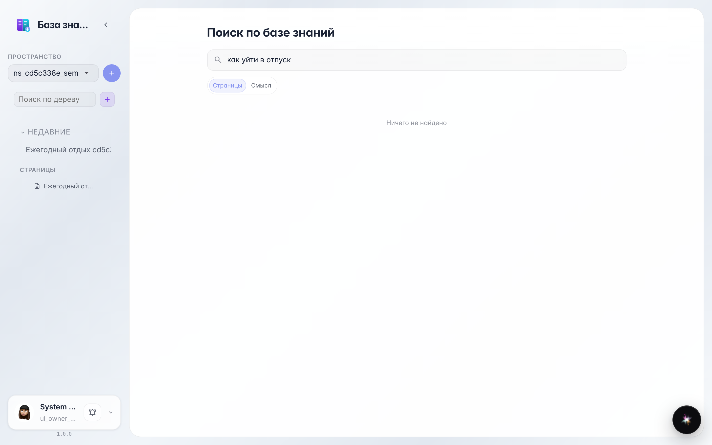
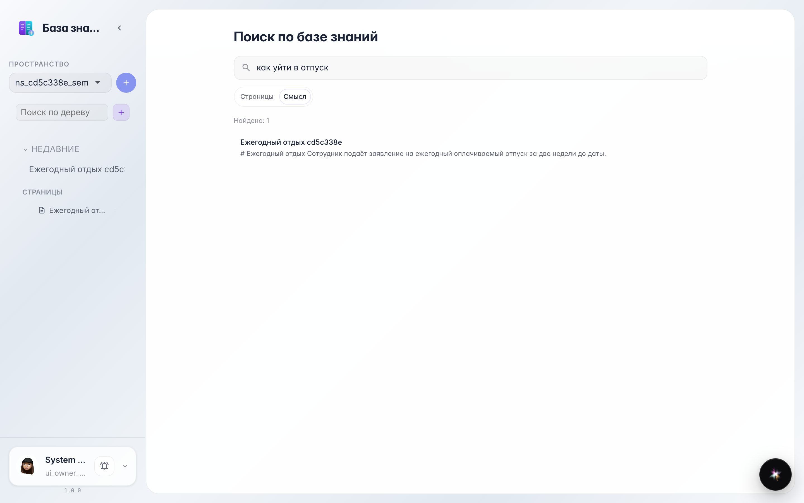
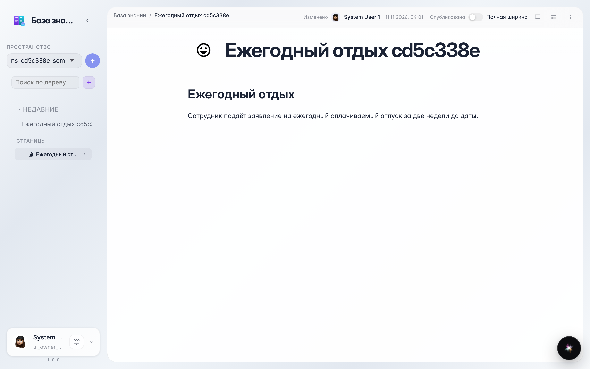

# Wiki: text search vs meaning search

**Purpose:** the knowledge base searches two ways — by exact words and by the meaning of a phrase.

**Problems solved:** can't remember the exact document title? The «Meaning» mode finds the page by description even when the words differ.

**Result:** the page is found by meaning — with no exact word match.

## Step 1. Text search found nothing

The query has none of the document's words — the «Pages» mode looks for exact matches and honestly reports «Nothing found». That doesn't mean the page is missing.

## Step 2. Meaning found the page

Switch to «Meaning»: search understands that «going on leave» is about «annual rest» and shows the right page. This runs the real semantic index of the knowledge base.

## Step 3. The page opened

Clicking the result opens the page — read and edit as usual.

**Summary.** Don't remember exact words — search by meaning: the knowledge base will find what you need.

