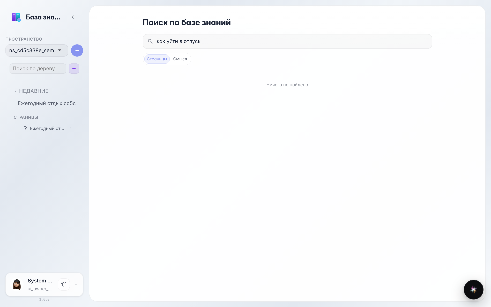
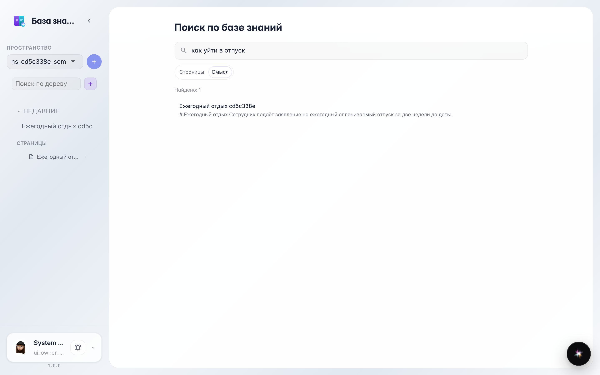
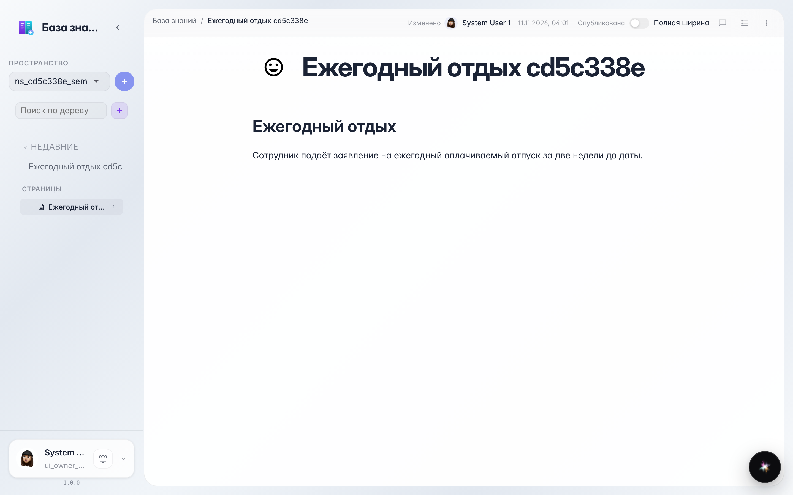

# Wiki: поиск по тексту и по смыслу

**Для чего:** база знаний ищет двумя способами — по точным словам и по смыслу фразы.

**Какие проблемы решает:** не помните точное название документа? Режим «Смысл» найдёт страницу по описанию, даже если слова в запросе другие.

**Результат:** страница найдена по смыслу — без точного совпадения слов.

## Шаг 1. Поиск по тексту не нашёл

В запросе нет слов из документа — режим «Страницы» ищет точные совпадения и честно отвечает «Ничего не найдено». Это не значит, что страницы нет.

## Шаг 2. «Смысл» нашёл страницу

Переключаемся на «Смысл»: поиск понимает, что «уйти в отпуск» — это про «ежегодный отдых», и показывает нужную страницу. Работает настоящий смысловой индекс базы знаний.

## Шаг 3. Страница открылась

Клик по результату открывает страницу — дальше читаете и правите как обычно.

**Итог.** Не помните точные слова — ищите по смыслу: база знаний найдёт нужное.

