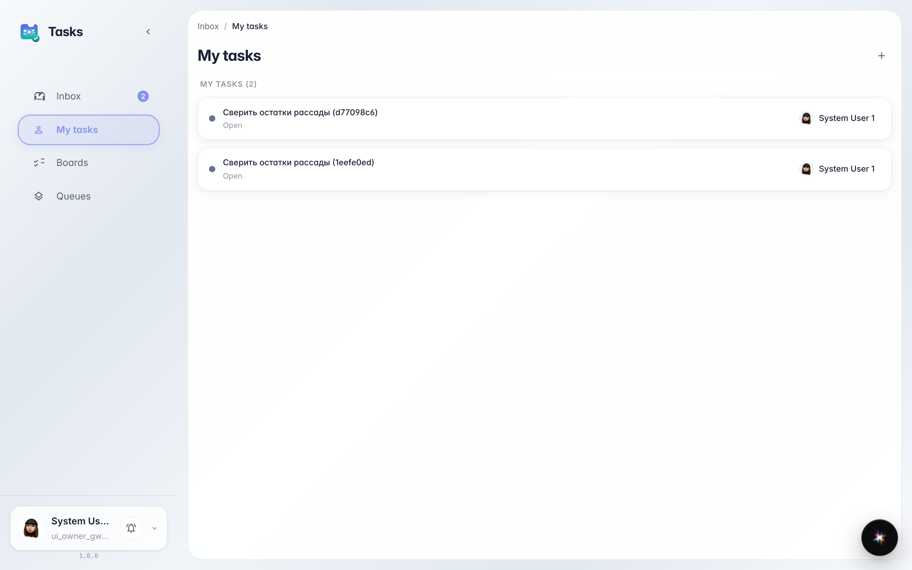
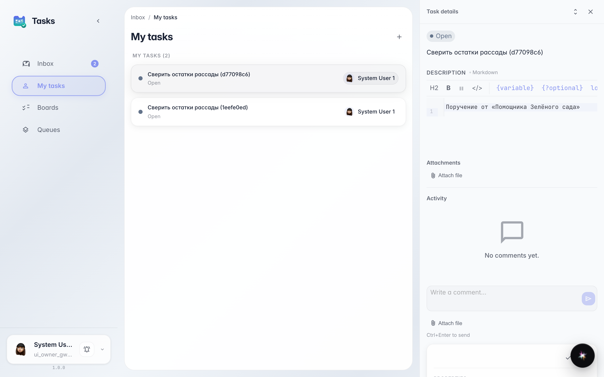
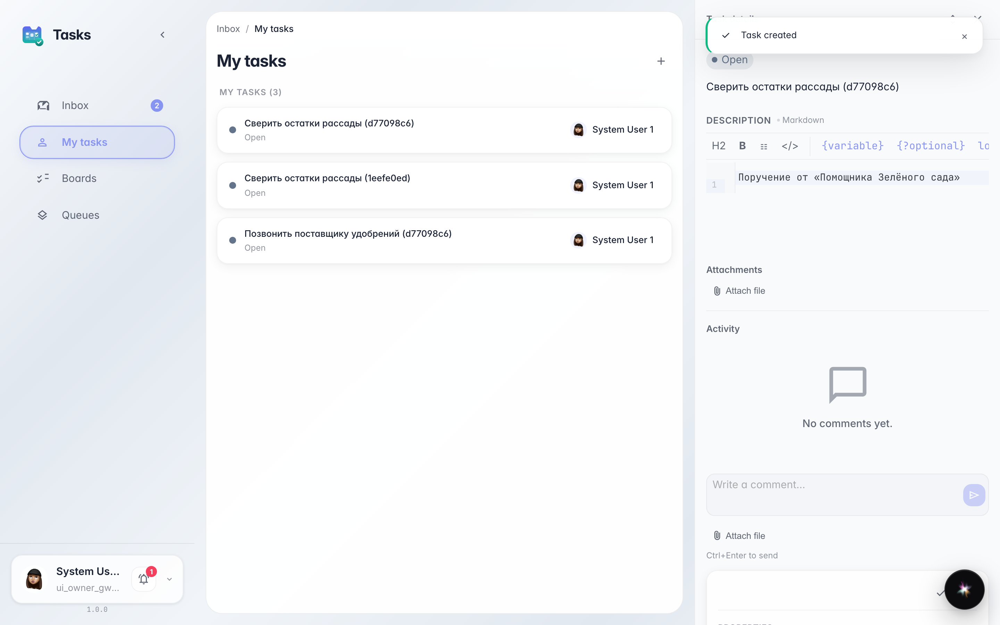

# My tasks: everything assigned to me

**What for:** the My tasks page lists work assigned personally to you — by a colleague, a manager or a platform agent.

**Problems solved:** no need to ask in chat what's on you: the whole list is in one place, and you can add your own task right here.

**Result:** you see your tasks, open any of them for details and create a personal task in a minute.

## Step 1. Open My tasks

In the tasks service, pick My tasks in the side menu. It shows only work assigned personally to you — no colleagues' errands or shared queues.

## Step 2. Open a task for details

Clicking a row opens the task card on the right: description, status and discussion. You can start the task or close it right here.

## Step 3. Create a personal task

**Result demonstration.** The + button in the header creates a task assigned to you right away — it appears in the list at once. A handy way to record promises to yourself: call, check, send.

**Summary.** Now you know where your work lives: the My tasks list shows assigned items and lets you add your own in a second.

