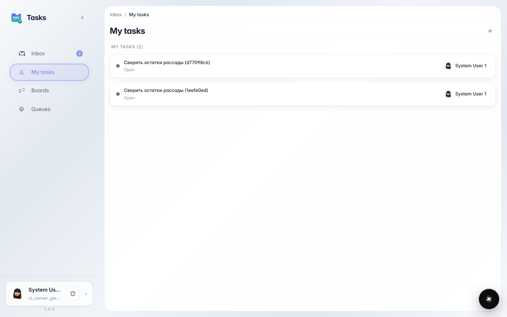
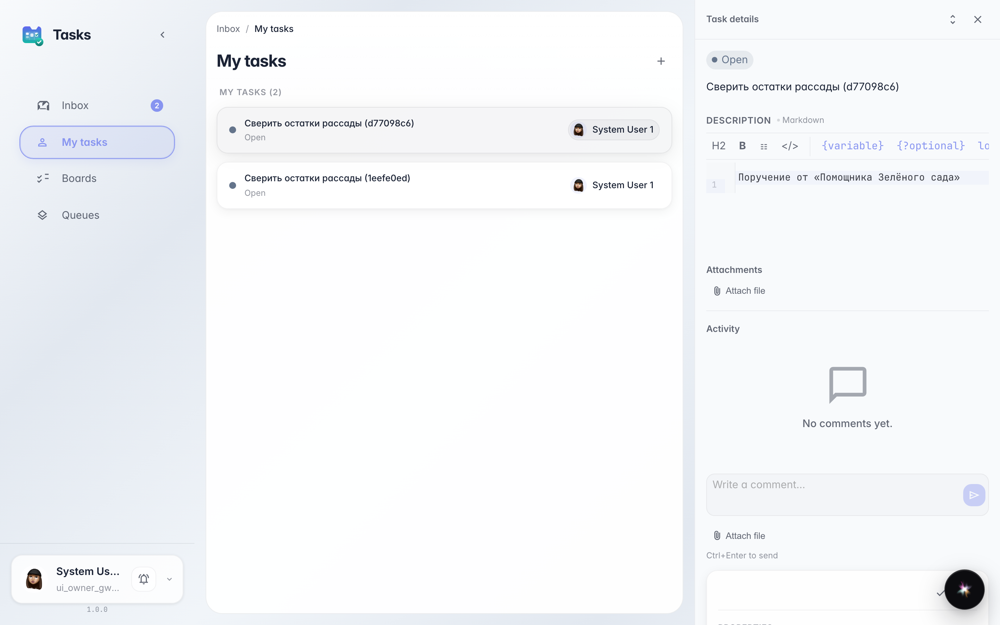
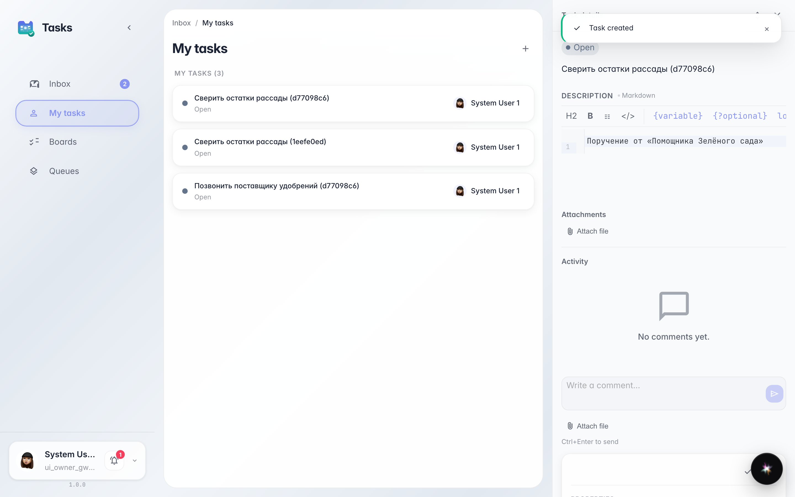

# Мои задачи: всё, что назначено мне

**Для чего:** страница «Мои задачи» показывает список дел, которые назначили лично вам — коллега, руководитель или агент платформы.

**Какие проблемы решает:** не нужно спрашивать в чате, что на вас висит: весь список в одном месте, а свою задачу можно добавить прямо здесь.

**Результат:** вы видите свои задачи, открываете любую для деталей и создаёте личную задачу за минуту.

## Шаг 1. Откройте «Мои задачи»

В сервисе задач в боковом меню выберите «Мои задачи». Здесь только то, что назначено лично вам — без чужих поручений и общих очередей.

## Шаг 2. Откройте задачу для деталей

Нажатие на строку открывает карточку задачи справа: описание, статус и обсуждение. Здесь же задачу можно взять в работу или закрыть.

## Шаг 3. Создайте личную задачу

**Демонстрация результата.** Кнопка «+» в шапке создаёт задачу, которая сразу назначается вам и появляется в списке. Так удобно фиксировать обещания себе: позвонить, проверить, отправить.

**Итог.** Теперь вы знаете, где живут ваши задачи: список «Мои задачи» показывает поручения и позволяет добавить своё за секунду.

