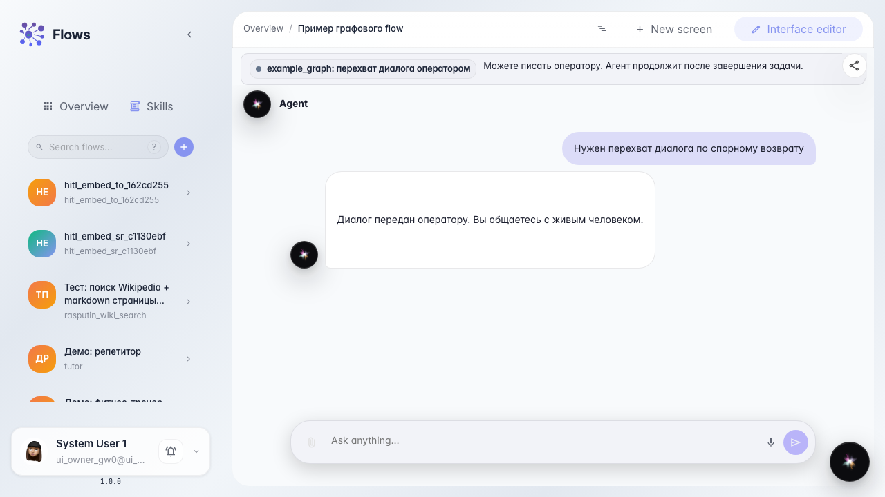
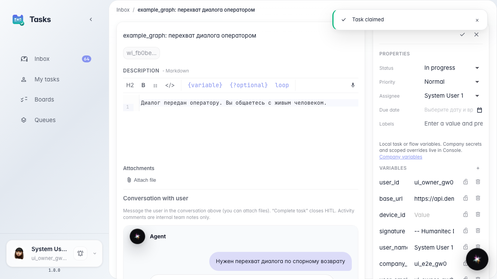
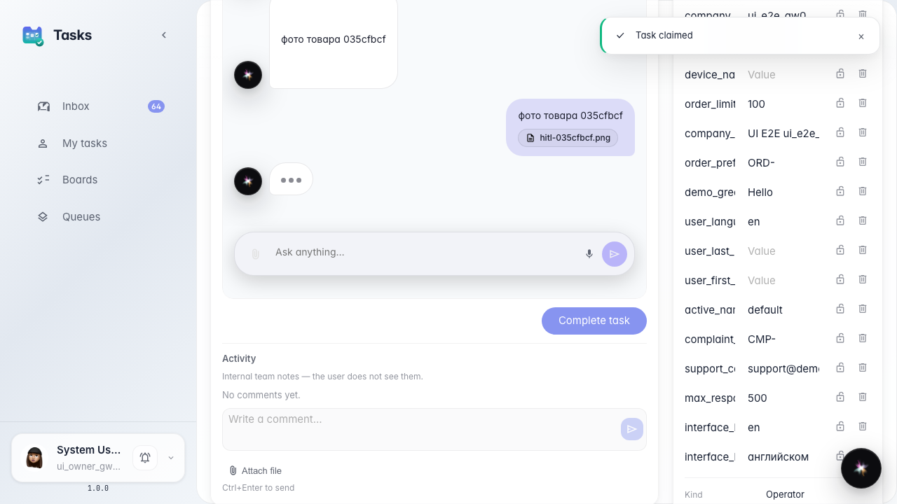
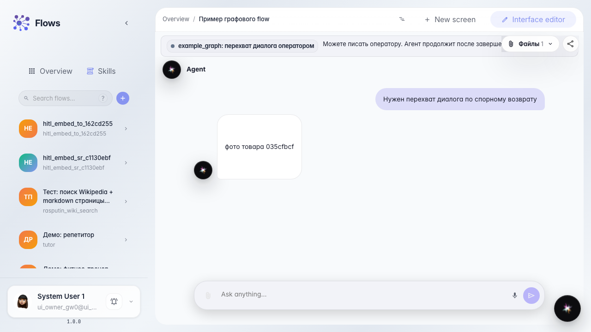

# Operator attaches a file in the customer reply

**What for:** this guide shows how to send the customer an attachment from the embedded task chat, not via internal comments.

**Problems it solves:** a product photo is easy to drop into Activity, and the customer never sees it.

**Result:** the file goes into the HITL dialog and the customer sees the attachment in their chat.

## Step 1. Take the chat to an operator task

The customer writes about a disputed return. A support-queue task appears — that is where the operator replies.

## Step 2. Open the task and claim it

In Tasks open the card and claim it. The chat shows the input and an attach control.

## Step 3. Attach the photo and send the reply

Pick a file in the chat composer and add a caption. The message with the attachment goes to the customer, not to Activity.

## Step 4. Check the attachment in the customer chat

**Result demonstration.** The customer chat shows the photo caption. The file arrived in the same dialog as the operator text.

**Summary.** You can send attachments to the customer from the embedded task chat.

