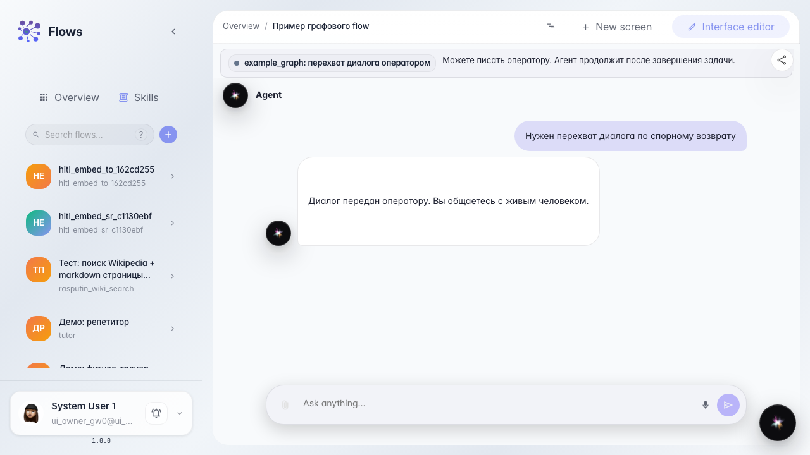
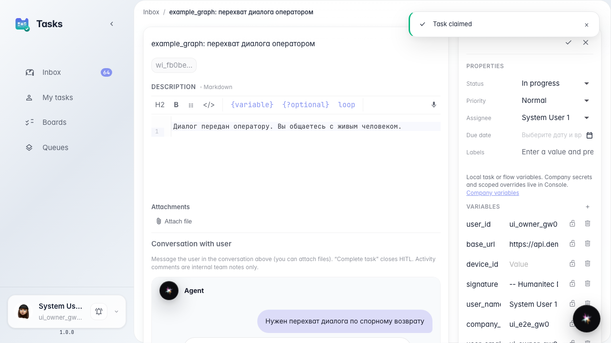
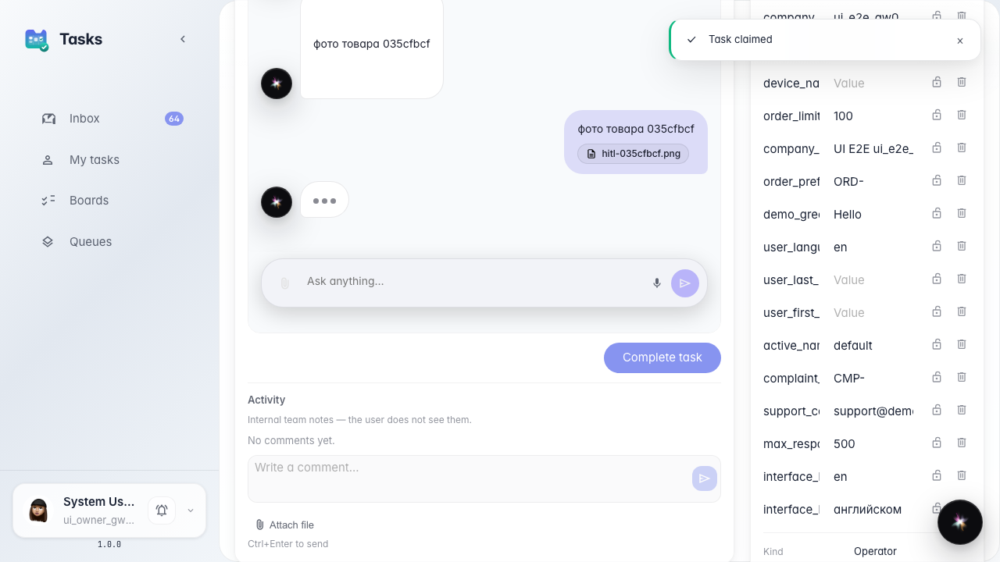
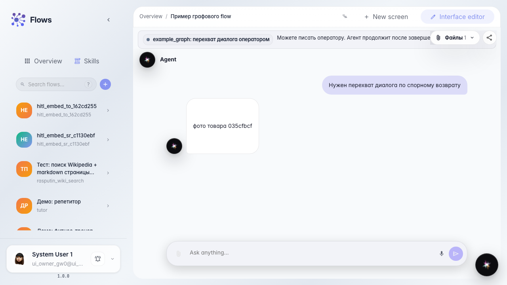

# Оператор прикрепляет файл в ответ покупателю

**Для чего:** эта инструкция покажет, как отправить покупателю вложение из встроенного чата задачи, а не через внутренние комментарии.

**Какие проблемы решает:** фото товара или бланк возврата легко положить в «Активность», и покупатель его не увидит.

**Результат:** файл уходит в диалог HITL, покупатель видит вложение в своём чате.

## Шаг 1. Доведите чат до задачи оператора

Покупатель пишет про спорный возврат. Появляется задача в очереди поддержки — туда оператор и отвечает.

## Шаг 2. Откройте задачу и возьмите её в работу

В разделе задач откройте карточку и нажмите «Взять себе». Внизу чата есть поле ввода и кнопка вложения.

## Шаг 3. Прикрепите фото и отправьте ответ

Выберите файл в композере чата и напишите подпись. Сообщение с вложением уходит покупателю, не в ленту активности.

## Шаг 4. Проверьте вложение у покупателя

**Демонстрация результата.** В чате покупателя видна подпись к фото. Файл пришёл тем же диалогом, что текстовый ответ оператора.

**Итог.** Вы умеете слать вложения покупателю из встроенного чата задачи.

