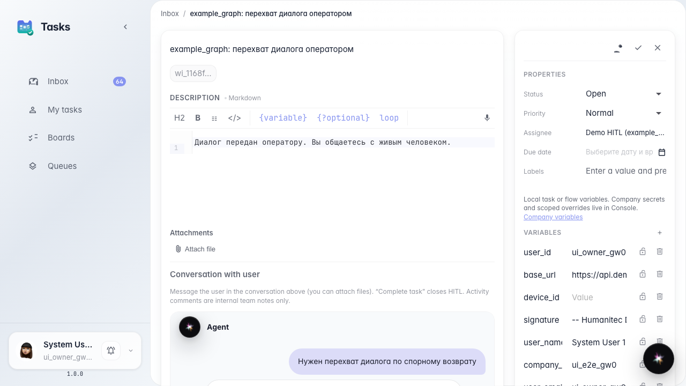
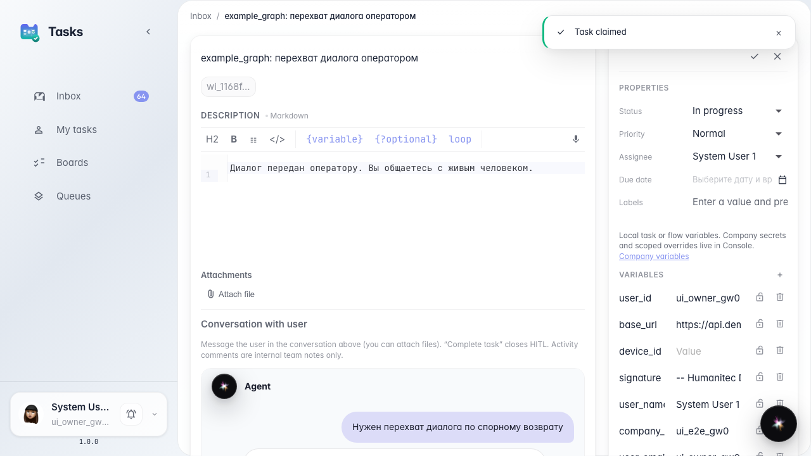
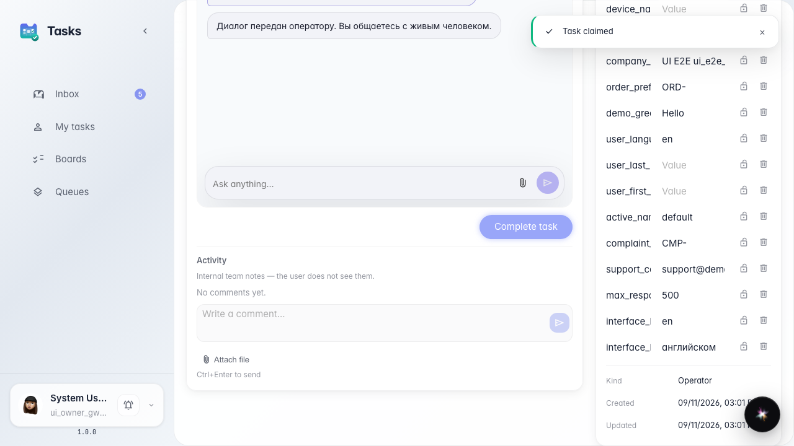
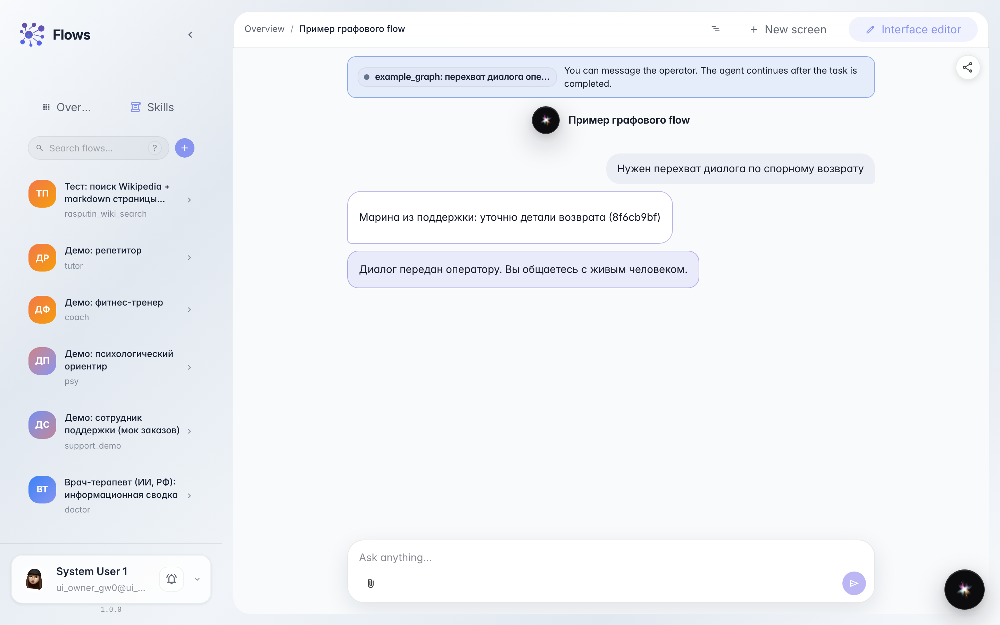

# Embedded operator chat in an HITL task

**What for:** this guide shows how an operator in Tasks sees the same customer dialog as in the agent chat and replies from the task card using the same chat UI as in Flows.

**Problems it solves:** without an embedded chat, operators switch between services and cannot see the full customer–agent conversation in one place.

**Result:** the operator reads history, sends a reply from the task card, and the customer immediately sees the message in their chat.

## Step 1. Open the operator task with embedded chat

In Tasks, open the operator handoff card. The center shows Conversation with user: the same chat the customer has in Flows, including history before the handoff.

## Step 2. Claim the task and check the composer

Click claim on the task card. The chat shows the input field and send button — the same composer as in Flows and embed chat. The operator messages the customer directly.

## Step 3. Send a reply to the customer

Type your message and send. It appears in the task chat as an operator reply — no separate window and no copying from another service.

## Step 4. Verify the reply in the customer chat

**Result demonstration.** The customer chat shows the operator reply. The waiting banner clears after the task completes.

**Summary.** In single-reply mode write only in Reply and complete; Activity is for internal team notes.

