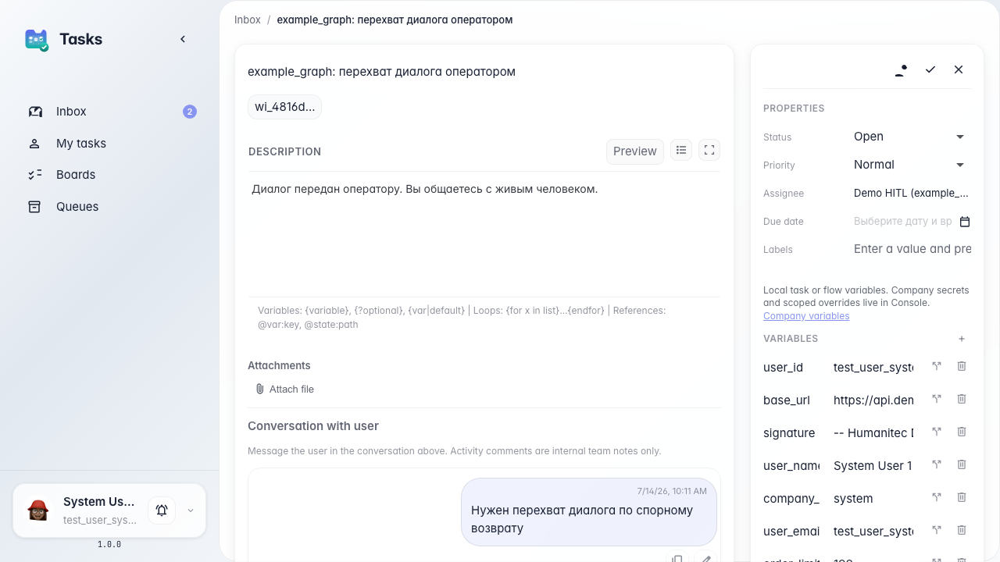
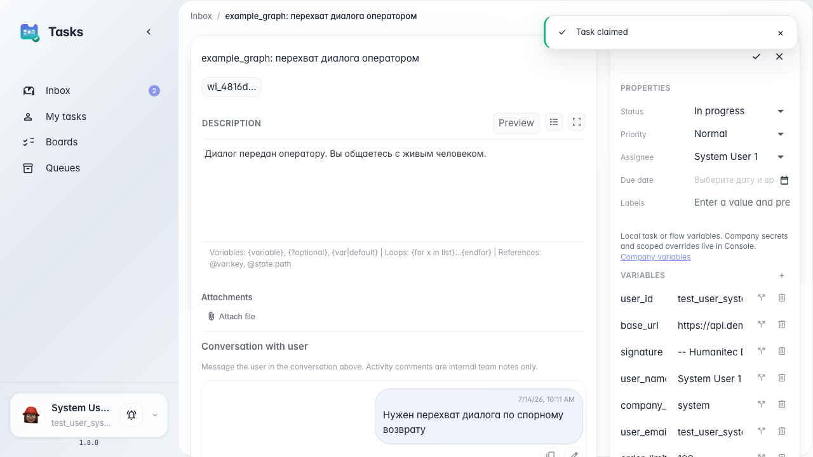
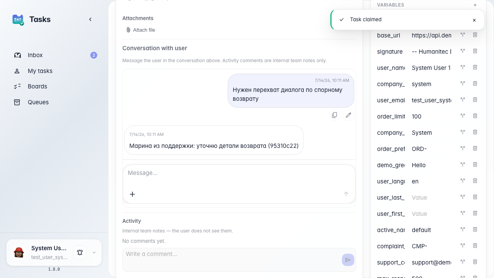
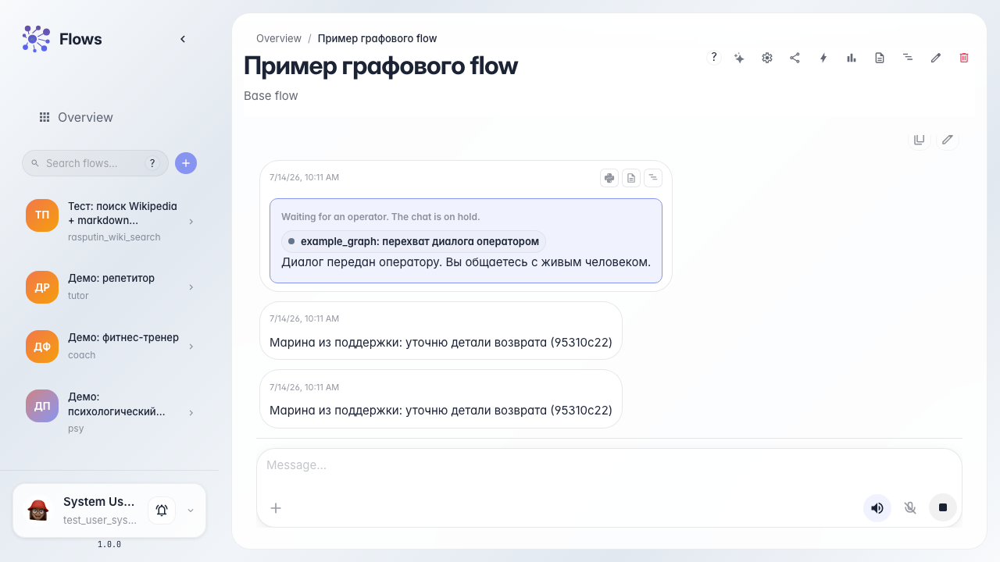

# Встроенный чат оператора в задаче HITL

**Для чего:** эта инструкция покажет, как оператор в разделе задач видит тот же диалог с покупателем, что и в чате агента, и отвечает из карточки задачи — тем же интерфейсом чата, что в Flows.

**Какие проблемы решает:** без встроенного чата оператору приходится переключаться между сервисами и не видит полную переписку покупателя с агентом в одном месте.

**Результат:** оператор читает историю, отправляет ответ из карточки задачи, а покупатель сразу видит сообщение в своём чате.

## Шаг 1. Откройте задачу оператора с встроенным чатом

В разделе задач откройте карточку передачи оператору. В центре — блок «Диалог с пользователем»: тот же чат, что у покупателя в Flows, с историей переписки до передачи человеку.

## Шаг 2. Возьмите задачу и проверьте композер

Нажмите «Взять себе» в карточке. Внизу чата появляется поле ввода и кнопка отправки — тот же композер, что в чате Flows и на сайте с виджетом. Так оператор пишет покупателю напрямую.

## Шаг 3. Отправьте ответ покупателю

Введите текст и нажмите отправку. Сообщение появляется в ленте чата карточки задачи как ответ оператора — без отдельного окна и без копирования из другого сервиса.

## Шаг 4. Проверьте ответ в чате покупателя

**Демонстрация результата.** Вернитесь к чату покупателя с агентом: там уже виден ваш ответ оператора. Покупатель получает сообщение сразу, не дожидаясь закрытия задачи.

**Итог.** Теперь вы умеете работать с HITL-задачей во встроенном чате: читать полную историю, отвечать тем же композером, что в Flows, и видеть результат у покупателя в реальном времени.

