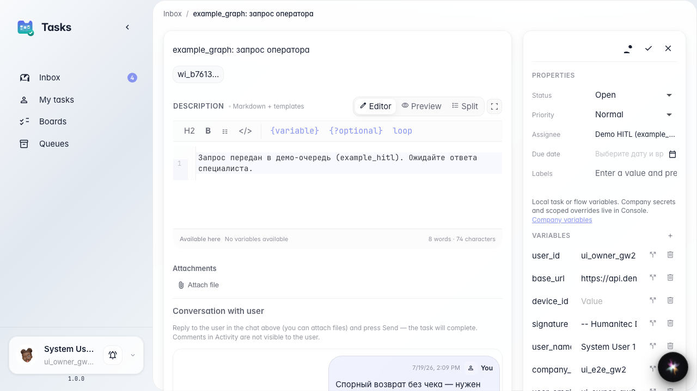
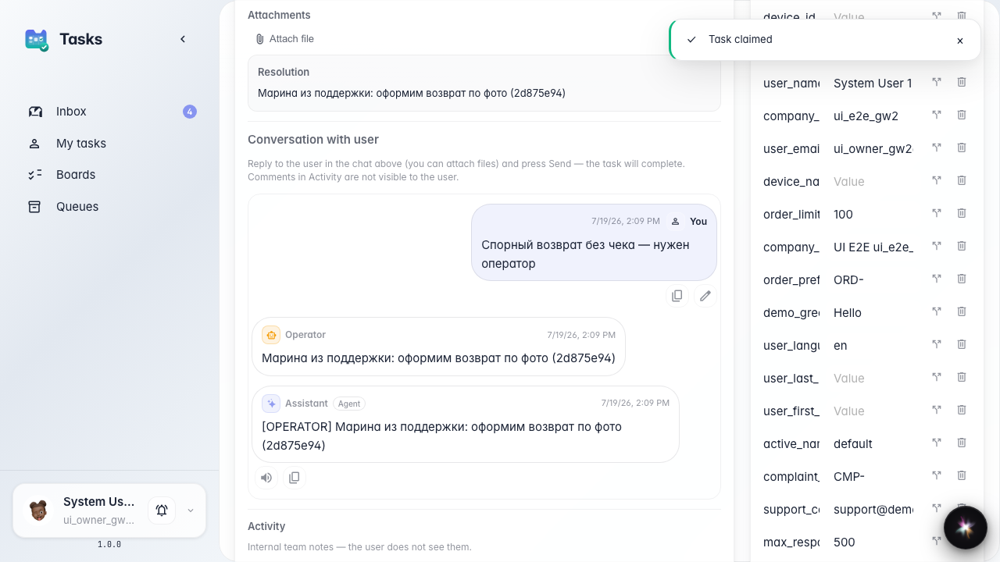
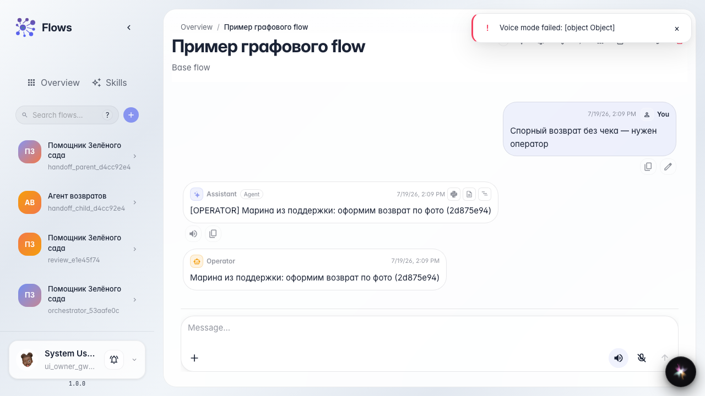

# Single operator reply and HITL complete

**What for:** this guide shows single-reply mode: the operator answers the customer via Reply and complete, not via Activity comments.

**Problems it solves:** internal team notes are easy to confuse with a customer reply — then the message never appears in the agent chat.

**Result:** after Reply and complete the customer sees the answer in their chat and the task closes.

## Step 1. Open the task with the single-reply hint

The card shows Conversation with user and a hint: reply to the customer only via Reply and complete. Activity comments are not visible to the user.

## Step 2. Reply and complete the task

Type the reply under the conversation and click Reply and complete. The task closes and the answer goes to the customer — not via the activity thread.

## Step 3. Verify the reply in the customer chat

**Result demonstration.** The customer chat shows the operator reply. The waiting banner clears after the task completes.

**Summary.** In single-reply mode write only in Reply and complete; Activity is for internal team notes.

