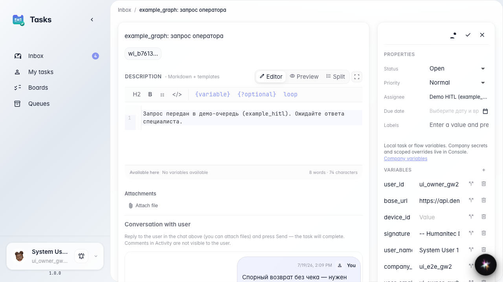
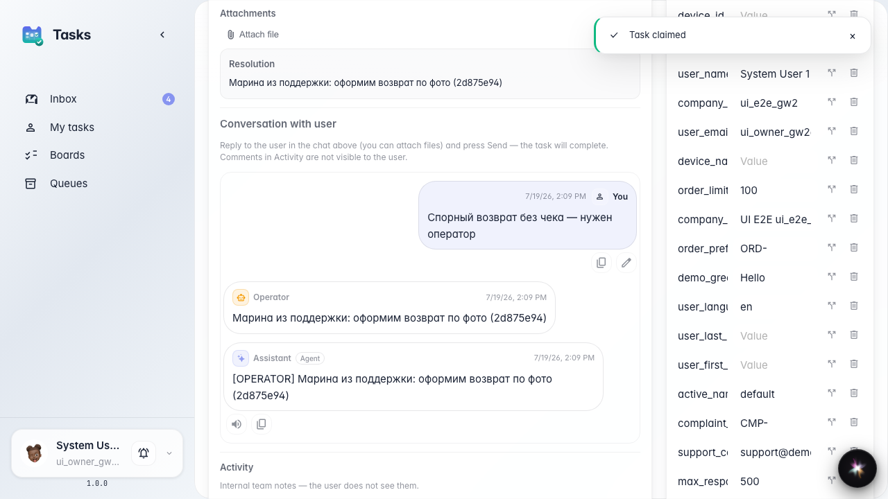
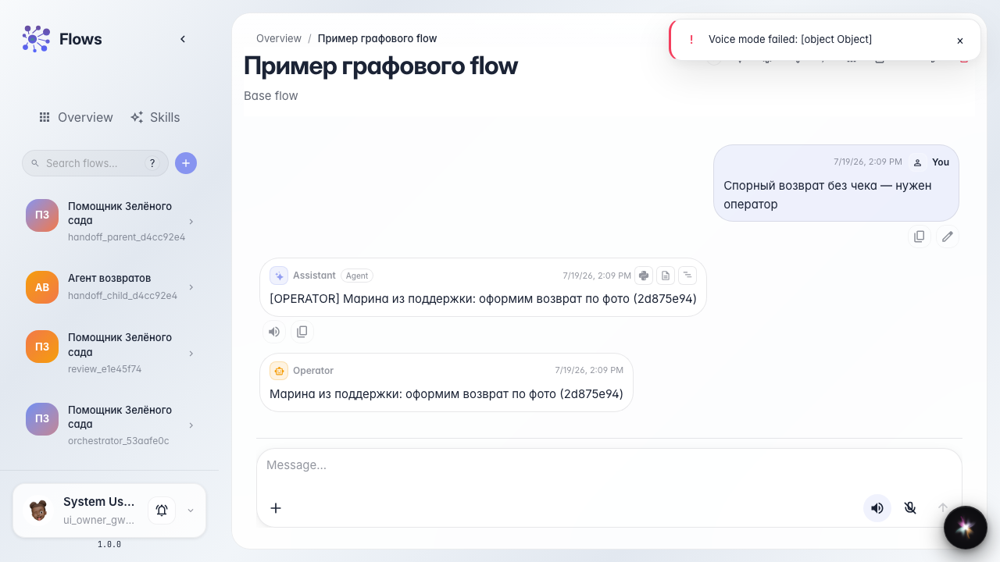

# Один ответ оператора и завершение HITL

**Для чего:** эта инструкция покажет режим одного ответа: оператор пишет покупателю через «Ответить и завершить», а не через комментарии в активности.

**Какие проблемы решает:** легко перепутать внутренние заметки команды с ответом покупателю — тогда сообщение не появится в чате агента.

**Результат:** после «Ответить и завершить» покупатель видит ответ в своём чате, задача закрывается.

## Шаг 1. Откройте задачу с подсказкой single_reply

В карточке видно блок «Диалог с пользователем» и подсказку: ответ покупателю — только через «Ответить и завершить». Комментарии в «Активности» пользователь не видит.

## Шаг 2. Ответьте и завершите задачу

Введите ответ в поле под диалогом и нажмите «Ответить и завершить». Задача закрывается, ответ уходит покупателю — не через ленту активности.

## Шаг 3. Проверьте ответ в чате покупателя

**Демонстрация результата.** В чате покупателя виден ответ оператора. Плашка ожидания снимается после завершения задачи.

**Итог.** В режиме одного ответа пишите только в «Ответить и завершить»; «Активность» — для внутренних заметок команды.

