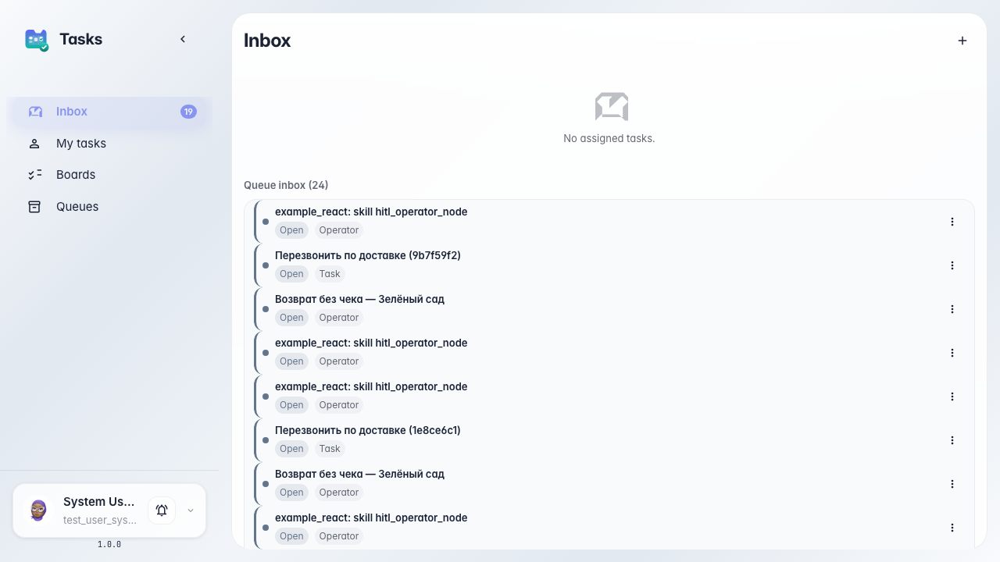
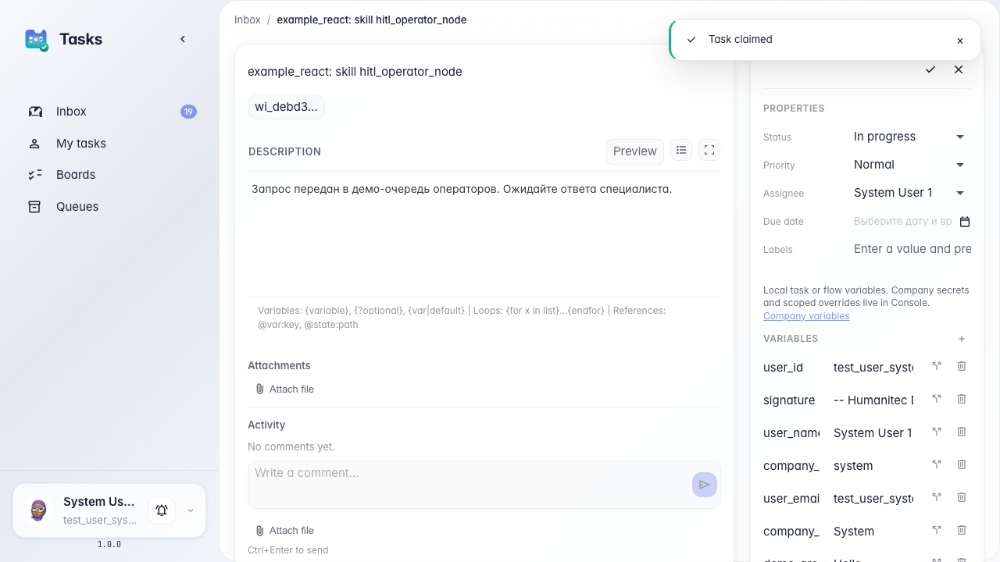
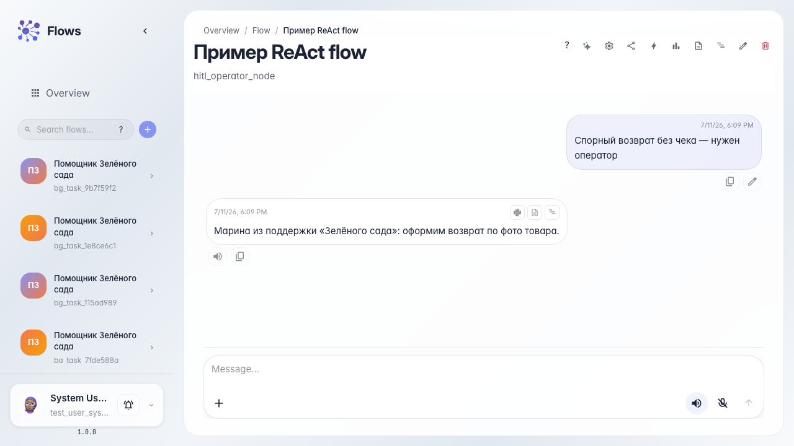

# Operator claims a task and replies once

**What for:** this guide shows the basic loop: the agent handed off — operator Marina replied — the customer dialog continued.

**Problems it solves:** operators are unsure where agent tasks come from and how to return an answer to the customer chat.

**Result:** Marina claimed a task from the Customer Support queue, replied, closed it, and the agent continued the dialog.

## Step 1. Open the operator inbox

Go to tasks and open inbox. The queue section shows a task from the Green Garden Assistant; complex customer requests land here.

## Step 2. Claim the task

Open the task card and click claim. Marina marks that she will answer the customer and sees the request context from the agent chat.

## Step 3. Complete the task with a customer reply

**Result demonstration.** Close the task with the reply text. Marina's support message appears in the customer chat; the agent continues with the operator answer.

**Summary.** You now know the task path: from agent chat to inbox, claim, reply once, and return the result to the customer.

