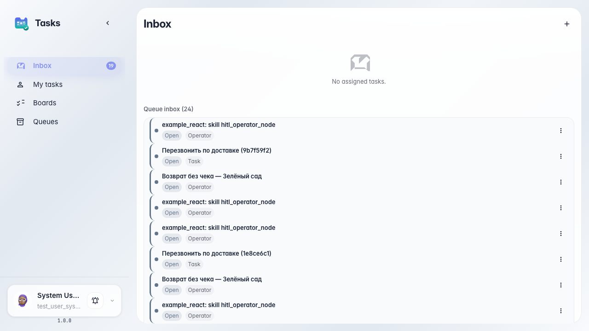
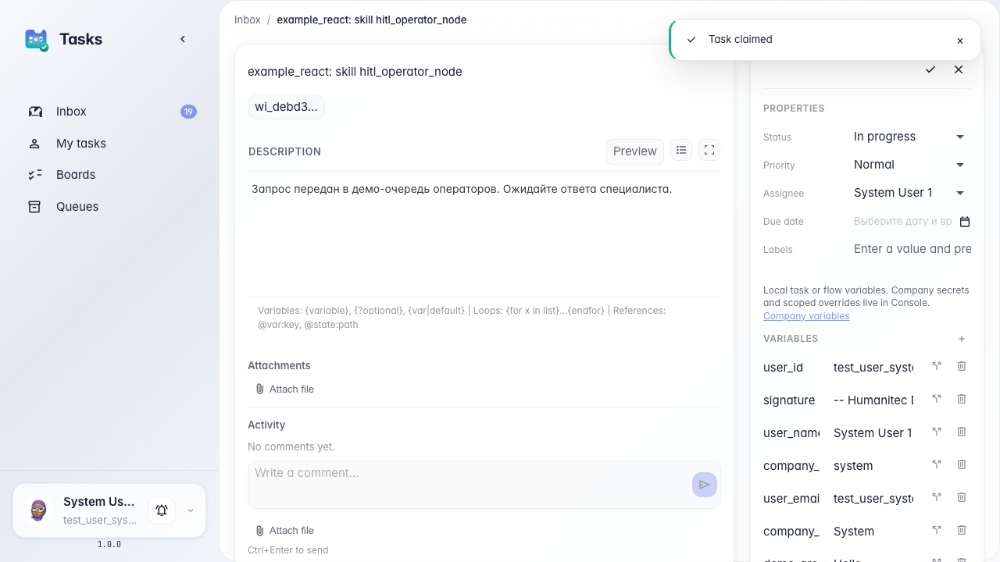
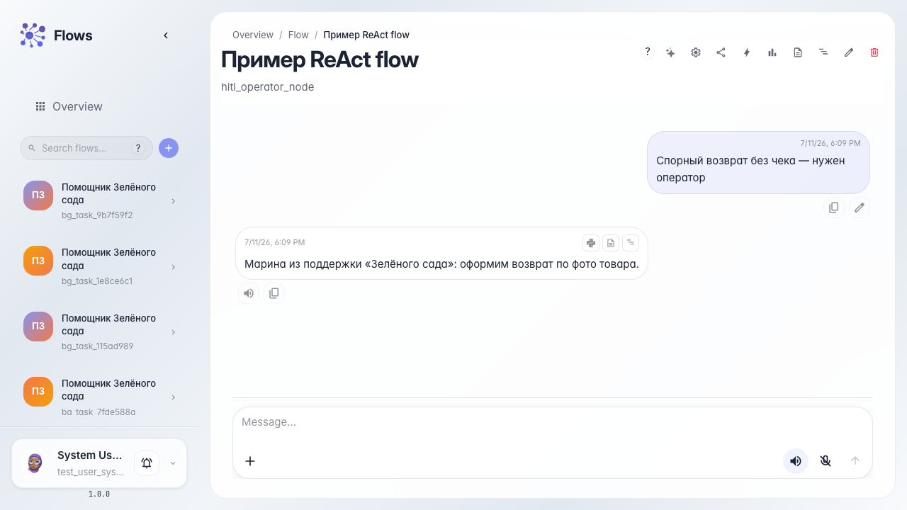

# Оператор берёт задачу и отвечает один раз

**Для чего:** эта инструкция покажет базовый цикл: агент передал обращение — оператор Марина ответила — диалог с покупателем продолжился.

**Какие проблемы решает:** оператор не понимает, откуда приходят задачи агента и как вернуть ответ в чат покупателю.

**Результат:** Марина взяла задачу из очереди «Поддержка клиентов», ответила и закрыла её — агент продолжил диалог.

## Шаг 1. Откройте входящие оператора

Перейдите в раздел задач и откройте входящие. В блоке очереди появится задача от «Помощника Зелёного сада» — сюда попадают сложные обращения покупателей.

## Шаг 2. Возьмите задачу себе

Откройте карточку задачи и нажмите «Взять себе». Так Марина фиксирует, что именно она отвечает покупателю, и видит контекст обращения из чата агента.

## Шаг 3. Завершите задачу с ответом покупателю

**Демонстрация результата.** Закройте задачу с текстом ответа. В чате покупателя появляется сообщение Марины из поддержки — агент продолжает диалог с учётом ответа оператора.

**Итог.** Теперь вы знаете путь задачи: из чата агента во входящие, взять, ответить один раз и вернуть результат покупателю.

