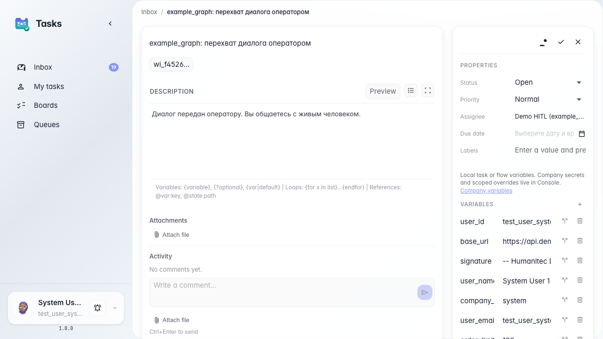
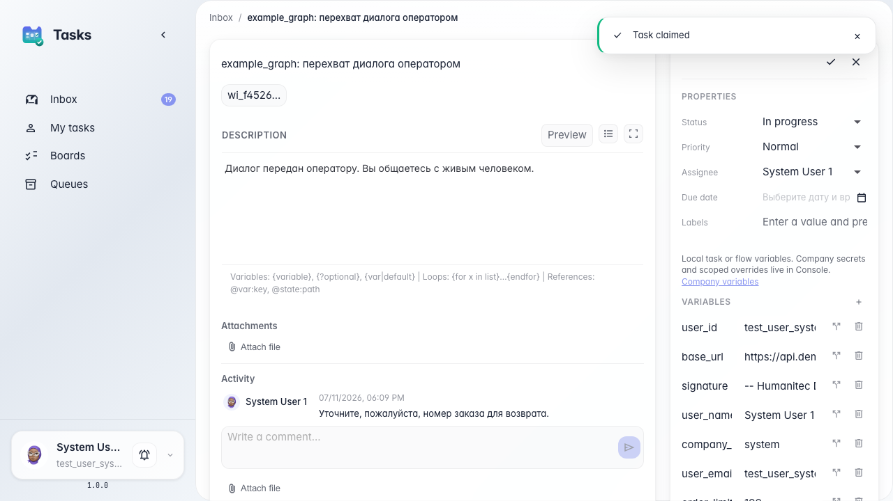
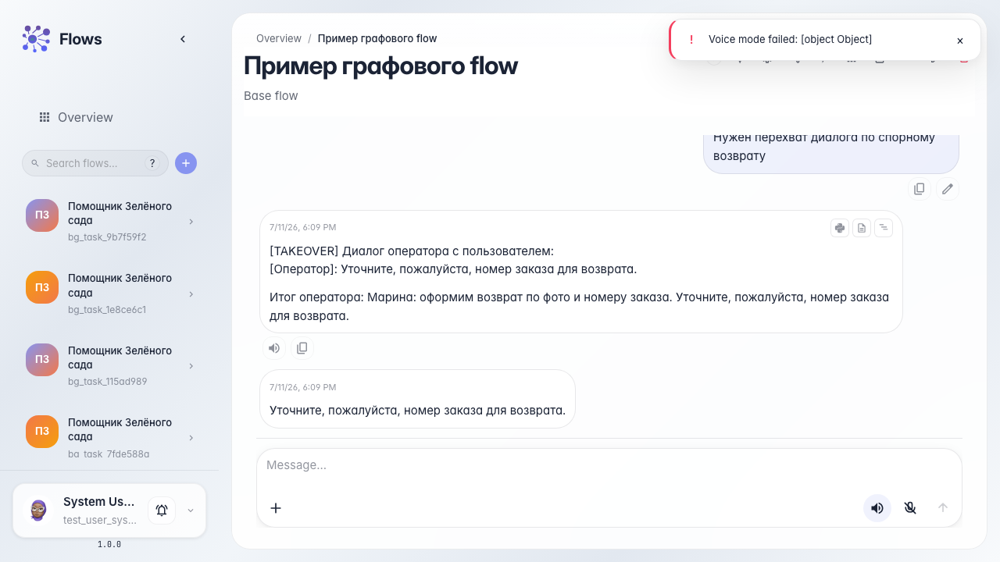

# Operator takes over the live dialog

**What for:** this guide shows dialog takeover mode when operator Marina needs a conversation, not a single reply.

**Problems it solves:** for a disputed return one message is not enough; details must be clarified in a live dialog.

**Result:** Marina chats in the task, completes it, and the agent picks up the outcome and continues with the customer.

## Step 1. Open the takeover-mode task

In the demo agent chat, type takeover trigger text; a full dialog takeover task is created. Open it in tasks; Marina sees the disputed return context.

## Step 2. Send a follow-up question to the customer

Claim the task and write a follow-up in the task thread. In takeover mode the operator runs a live dialog instead of a single final reply.

## Step 3. Complete takeover with dialog outcome

**Result demonstration.** Close the task with the conversation outcome. Marina's reply appears in the customer chat; the agent picks up the full operator dialog and continues service.

**Summary.** You can now tell single-reply from takeover and run a multi-step operator–customer conversation.

