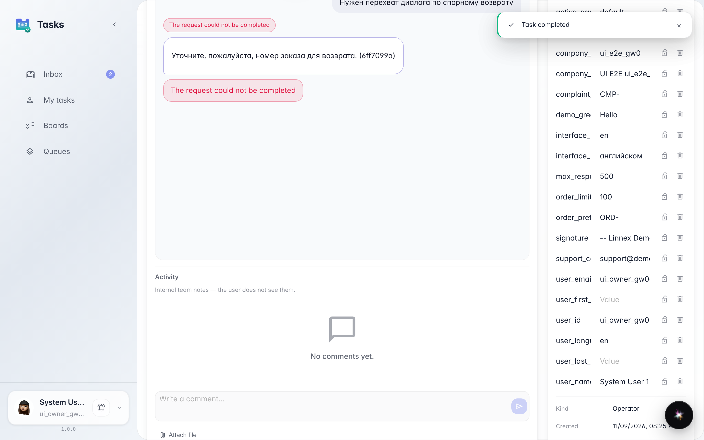
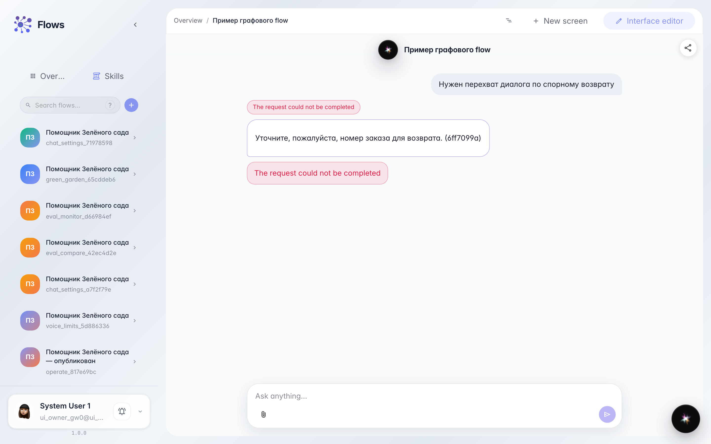

# Operator takes over the live dialog

**What for:** this guide shows dialog takeover mode when operator Marina needs a conversation, not a single reply.

**Problems it solves:** for a disputed return one message is not enough; details must be clarified in a live dialog.

**Result:** Marina chats in the task, completes it, and the agent picks up the outcome and continues with the customer.

## Step 1. Open the takeover-mode task

In the demo agent chat, type takeover trigger text; a full dialog takeover task is created. Open it in Tasks: the center shows the same chat the customer has.

## Step 2. Write to the customer in the task chat

Claim the task and send a follow-up in the embedded chat, not in Activity. In takeover this is a live dialog with the customer.

## Step 3. Click Complete task

When the details are in, click Complete task under the chat. This closes takeover and returns the dialog to the agent.

## Step 4. Confirm the agent continued the dialog

**Result demonstration.** The customer chat shows Marina's reply from the embedded chat. The waiting banner is gone — the agent picked up.

**Summary.** You can chat in the task and end takeover with the button, not with an Activity comment.

