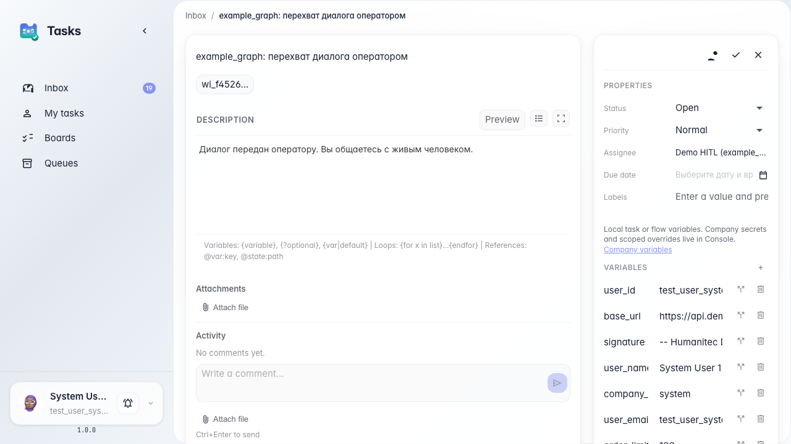
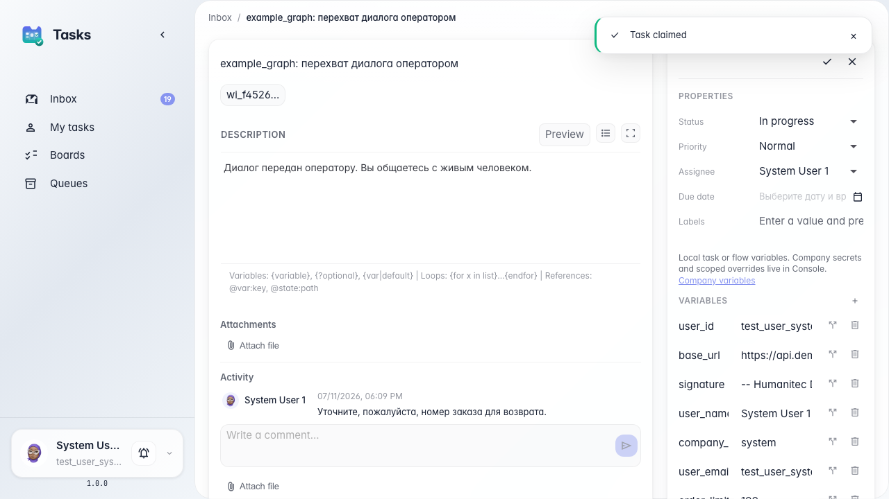
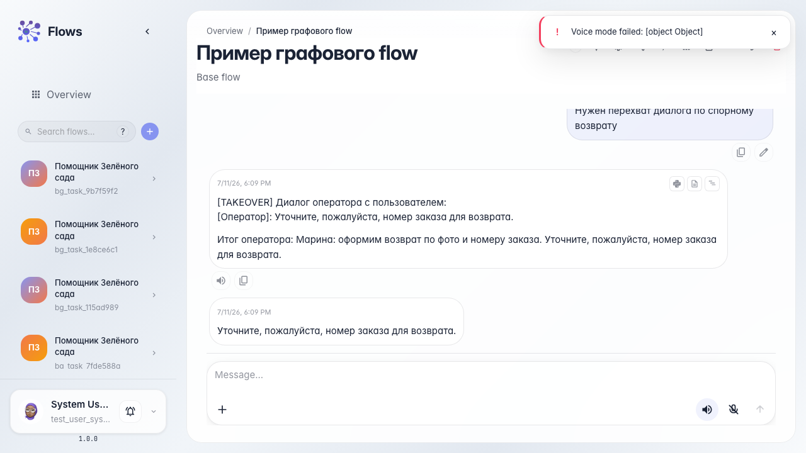

# Оператор ведёт живой диалог с покупателем

**Для чего:** эта инструкция покажет режим «перехват диалога», когда оператору Марине нужен не один ответ, а переписка с покупателем.

**Какие проблемы решает:** по спорному возврату одного сообщения мало — нужно уточнять детали в живом диалоге.

**Результат:** Марина ведёт переписку в задаче, завершает её — агент подхватывает итог и продолжает с покупателем.

## Шаг 1. Откройте задачу режима перехвата

В чате демо-агента напишите «перехват» — создаётся задача с полным перехватом диалога. Откройте её в разделе задач: Марина видит контекст спорного возврата.

## Шаг 2. Напишите покупателю уточняющий вопрос

Возьмите задачу и напишите уточняющий вопрос в ленте задачи. В режиме перехвата оператор ведёт живой диалог, а не ограничивается одним финальным ответом.

## Шаг 3. Завершите перехват с итогом диалога

**Демонстрация результата.** Закройте задачу с итогом переписки. В чате покупателя появляется ответ Марины — агент подхватывает весь диалог оператора и продолжает обслуживание.

**Итог.** Теперь вы умеете отличать «один ответ» от «перехвата» и вести многошаговый разговор оператора с покупателем.

