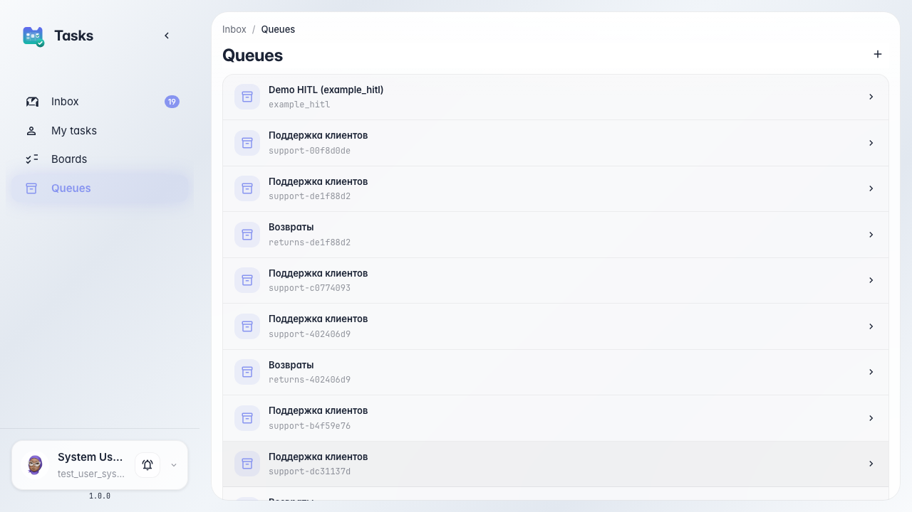
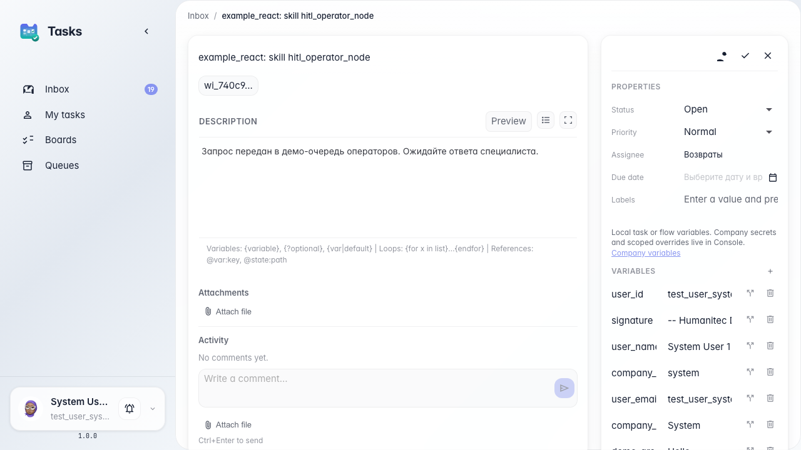

# Route and reassign operator tasks

**What for:** this guide helps you route different requests to different queues and pass a task to another assignee.

**Problems it solves:** returns and general questions get mixed; sometimes a task must go to a colleague in another queue.

**Result:** a task from Customer Support is reassigned to the Returns queue for separate handling.

## Step 1. Create support and returns queues

The queues section shows Customer Support and Returns. Different request types can go to different inboxes so operators do not mix general questions and disputed returns.

## Step 2. Reassign the task to the returns queue

**Result demonstration.** Open the task after reassignment; it is now in the Returns queue. Marina or a colleague in that queue will see it in inbox and handle it separately from general support.

**Summary.** You can now route agent tasks between Customer Support and Returns queues.

