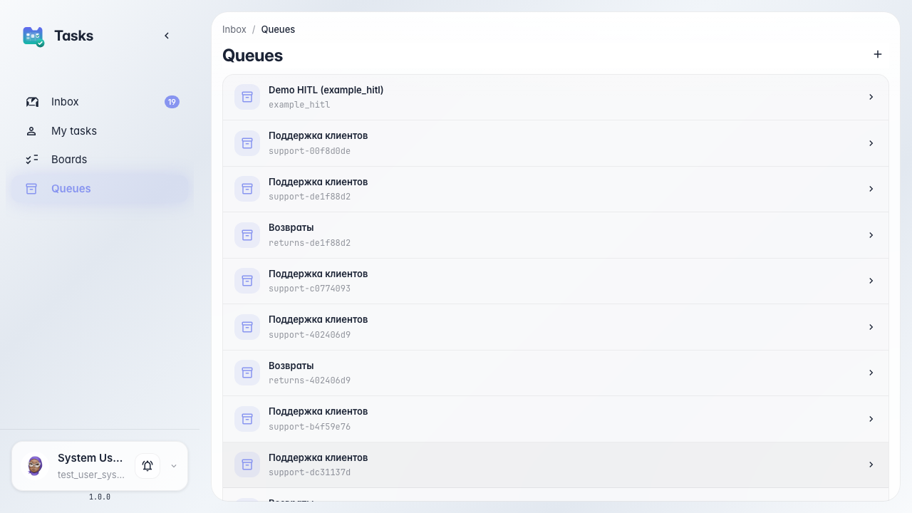
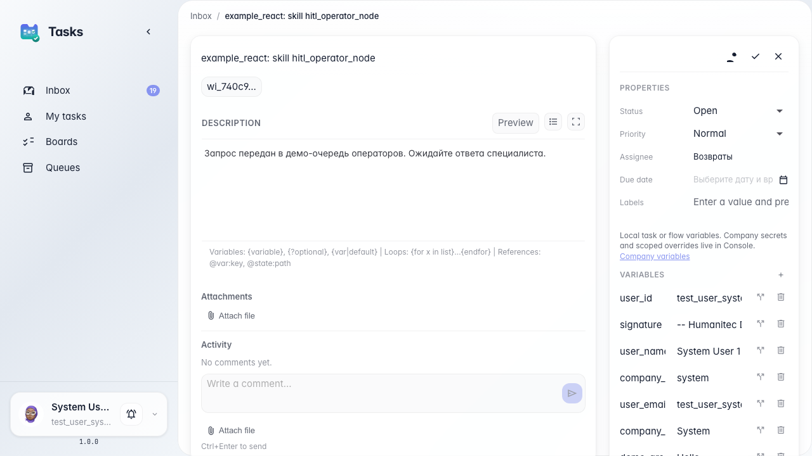

# Маршрутизация и переназначение задач

**Для чего:** эта инструкция поможет направлять разные обращения в разные очереди и передавать задачу другому исполнителю.

**Какие проблемы решает:** возвраты и общие вопросы смешиваются; иногда задачу нужно отдать коллеге в другую очередь.

**Результат:** задача из «Поддержка клиентов» переназначена в очередь «Возвраты» для отдельной обработки.

## Шаг 1. Создайте очереди поддержки и возвратов

В разделе очередей видны «Поддержка клиентов» и «Возвраты». Разные типы обращений можно направлять в разные ящики, чтобы операторы не смешивали общие вопросы и спорные возвраты.

## Шаг 2. Переназначьте задачу в очередь возвратов

**Демонстрация результата.** Откройте задачу после переназначения — она теперь в очереди «Возвраты». Марина или коллега из этой очереди увидят её во входящих и смогут обработать отдельно от общей поддержки.

**Итог.** Теперь вы умеете маршрутизировать задачи агента между очередями «Поддержка клиентов» и «Возвраты».

