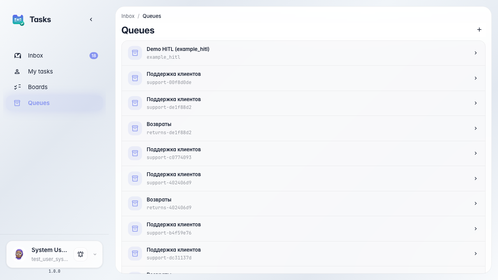
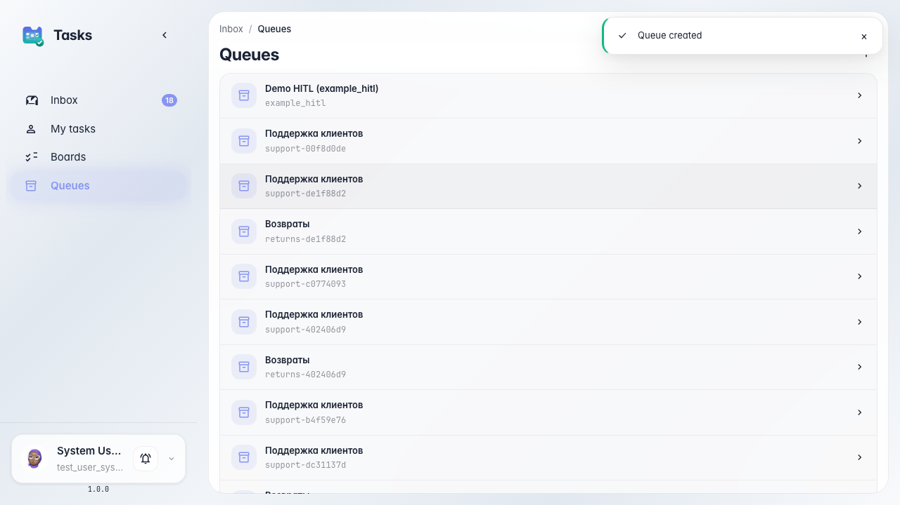
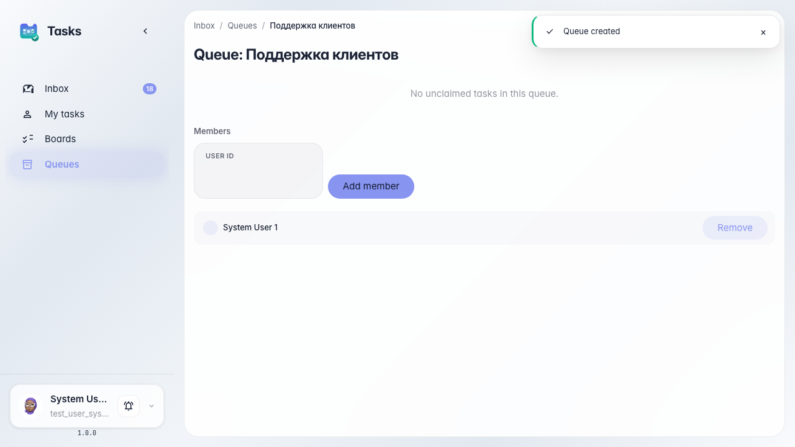

# Set up a support queue for the agent

**What for:** this guide helps you build a queue where agents route complex customer requests.

**Problems it solves:** without a queue and assigned people, there's no one to handle the agent's tasks.

**Result:** the Customer Support queue is created and shows an inbox section where agent tasks will arrive.

## Step 1. Open the queues section

In the tasks service, open the queues section. A queue is a shared task inbox operators pull from. This is where the agent will drop complex cases.

## Step 2. Create the support queue

Click create queue, enter the name Customer Support and a short identifier. After saving, the queue appears in the list.

## Step 3. Open the queue and its inbox

**Result demonstration.** Open the queue — inside there is an inbox section and a members list. Agent tasks land here, and this is where you add operators such as Marina.

**Summary.** You now have a support queue ready to receive requests from the agent.

