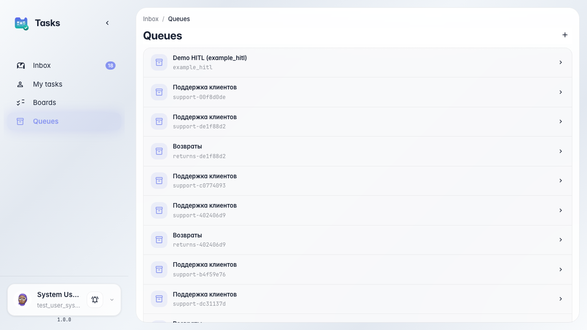
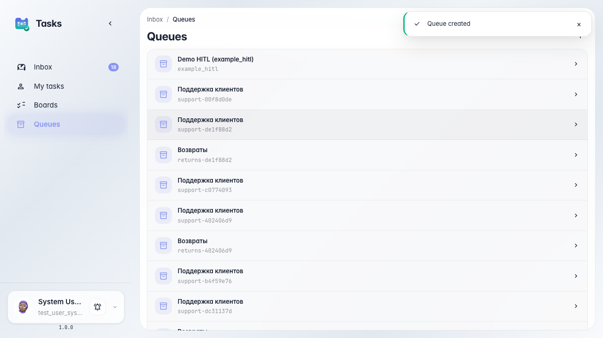
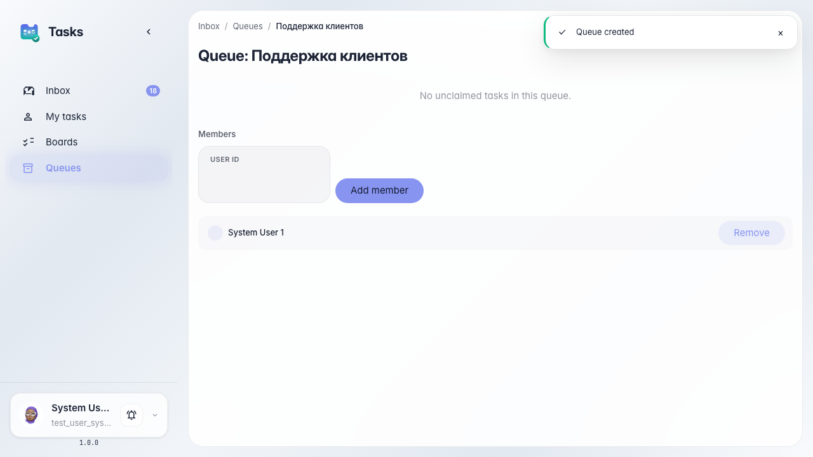

# Готовим очередь поддержки для агента

**Для чего:** эта инструкция поможет собрать очередь, в которую агенты будут передавать сложные обращения покупателей.

**Какие проблемы решает:** без очереди и назначенных людей задачи от агента просто некому разбирать.

**Результат:** создана очередь «Поддержка клиентов», и в ней появляется раздел входящих, куда будут попадать задачи от агента.

## Шаг 1. Откройте раздел очередей

В сервисе задач откройте раздел очередей. Очередь — это общий ящик задач, из которого операторы разбирают обращения. Сюда агент будет складывать сложные случаи.

## Шаг 2. Создайте очередь поддержки

Нажмите создание очереди, укажите название «Поддержка клиентов» и короткий идентификатор. После сохранения очередь появляется в списке.

## Шаг 3. Откройте очередь и её входящие

**Демонстрация результата.** Откройте очередь — внутри есть раздел входящих и список участников. Сюда попадут задачи от агента, и здесь добавляют операторов, например Марину.

**Итог.** Теперь у вас есть очередь поддержки, готовая принимать обращения от агента.

