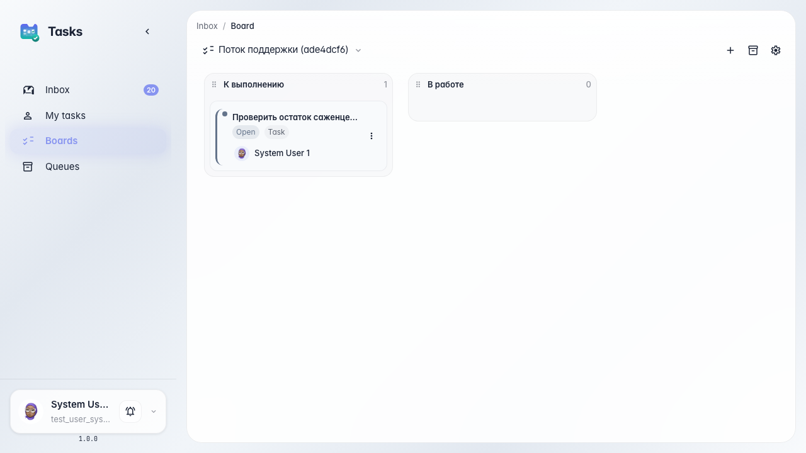

# Track operator work on a board

**What for:** this guide helps you keep the request flow under control on a kanban board, not only as an inbox list.

**Problems it solves:** the inbox list does not show the overall status of all agent and operator tasks.

**Result:** the board shows tasks in To do and In progress columns.

## Step 1. Open the tasks kanban board

In tasks, open the board. Columns show work stages: what is waiting and what operators such as Marina are already working on.

## Step 2. Find the agent task on the board

**Result demonstration.** The Green Garden Assistant task card sits in the To do column. The board shows the whole flow, not only the latest inbox item.

**Summary.** You can now view agent and operator tasks on the kanban board and control support flow status.

