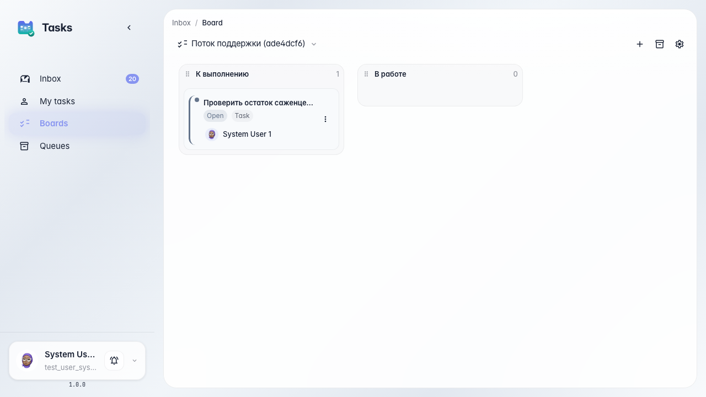

# Ведём задачи на доске

**Для чего:** эта инструкция поможет держать поток обращений под контролем на канбан-доске, а не только списком входящих.

**Какие проблемы решает:** список входящих не показывает общий статус всех задач от агента и операторов.

**Результат:** на доске видно задачи в колонках «К выполнению» и «В работе».

## Шаг 1. Откройте канбан-доску задач

В разделе задач откройте доску. Колонки показывают этапы работы: что ждёт выполнения, что уже в работе у операторов вроде Марины.

## Шаг 2. Найдите задачу агента на доске

**Демонстрация результата.** Карточка поручения от «Помощника Зелёного сада» лежит в колонке «К выполнению». С доски видно весь поток, а не только последнее входящее.

**Итог.** Теперь вы умеете смотреть задачи агента и операторов на канбан-доске и контролировать статус потока поддержки.

